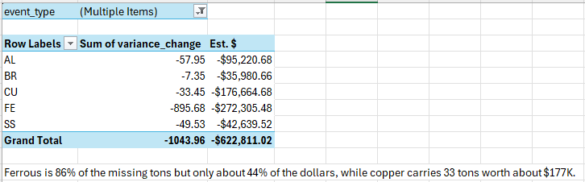
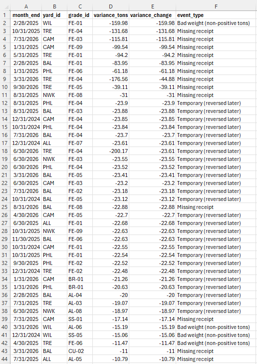

# Scrap Metal Inventory & Commercial Planning Analytics

## Project description

This project analyzes inventory for a fictional regional scrap-metal recycling network: eight yards in the NJ / PA / DE / MD corridor buying scrap from suppliers, sorting it into grades, and selling it to mills, foundries and export traders.

The goal is to answer the questions a commercial planning and inventory analyst is asked every week:

- How much material is on hand, by yard and grade, and what is it worth at today's market?
- Which inventory is aging, slow-moving or otherwise at risk?
- Where is the inventory sitting relative to yard capacity?
- Which material should Sales prioritize, and where should Logistics move it first?
- Are the underlying transaction records trustworthy, and do they agree with the inventory system?

The analysis is delivered as an Excel workbook built on Power Query, with a Python script that generates the simulated dataset.

## Scope of the business simulated

| Dimension | Detail |
|---|---|
| Yards | 8 (Camden, Philadelphia, Trenton, Newark, Wilmington, Allentown, Baltimore, Reading) |
| Metal groups | Copper, aluminum, brass & bronze, stainless steel, ferrous |
| Grades | 40 (e.g. Bare Bright Copper, 6061 Extrusions, Yellow Brass, 304 Stainless Solids, HMS 1) |
| Customers | 12 mills, smelters, foundries and export traders |
| History | 24 months, October 2024 to September 2026 |
| Volume | About 100,000 purchase receipts and 100,000 outbound loads |
| Unit | Short tons; prices in USD per short ton |

## Architecture

```
                 +--------------------+
                 |  generate_data.py  |   seeded, reproducible
                 +---------+----------+
                           |
      +--------------------+---------------------+
      |                    |                     |
      v                    v                     v
 data/reference/      data/raw/            data/system_snapshots/
 yards, grades,       transactions,        month-end balances,
 customers,           daily market         open FIFO lots,
 yard-grade map       benchmarks,          opening balances
                      daily grade prices
      |                    |                     |
      +--------------------+---------------------+
                           |
                           v
              Power Query (Excel)
              cleaning, standardization, data-quality flags
                           |
                           v
              Reconciliation model
              ledger balance vs. system balance, by yard,
              grade and month-end; variance classification
                           |
                           v
              Findings and exceptions
              summary tables, ranked exceptions, written findings
```

### Data layers

**Reference.** Static dimensions: yards with capacity, grades with metal group, standard load size and processing cost, customers with freight cost, and the list of grades each yard handles.

**Raw.** Extracts as an operational system would deliver them: the transaction ledger (receipts, shipments, physical-count adjustments), daily market benchmarks per metal group, and daily buy and sell prices per grade. The raw ledger contains the kinds of quality problems found in real extracts: inconsistent code formatting, duplicate rows, unit-of-measure and decimal errors, backdated shipments, missing records, and blank customers.

**System snapshots.** Balances as the inventory system reports them: month-end tons, average cost, book value and market value by yard and grade, split into age buckets (0-30, 31-60, 61-90, 90+ days); lots still open at the end of the period; and the opening balance.

**Validation.** A record of every planted data problem and every built-in business scenario, used to confirm the reconciliation logic finds what it should.

### Data model

| Table | Grain | Key fields |
|---|---|---|
| `transactions` | one row per receipt, shipment or adjustment | txn_id, date, yard_id, grade_id, txn_type, tons, unit_price, customer_id, lot_id |
| `yards` | one row per yard | yard_id, capacity_tons |
| `grades` | one row per grade | grade_id, metal_group, standard_load_tons, processing_cost_per_ton |
| `customers` | one row per customer | customer_id, customer_type, metal_groups_bought, freight_per_ton |
| `yard_grades` | one row per yard-grade handled | yard_id, grade_id |
| `market_benchmarks_daily` | metal group by day | benchmark_per_ton |
| `grade_prices_daily` | grade by day | buy_price, sell_price |
| `inventory_month_end` | yard by grade by month-end | tons_on_hand, avg_cost_per_ton, book_value, market_value, age buckets |
| `inventory_open_lots` | one row per open FIFO lot | lot_id, receipt_date, tons_remaining, cost_per_ton, age_days |

### Simulation logic

- **Prices.** Each metal group follows a mean-reverting price path with its own volatility, correlated to a shared market factor. Brass tracks copper. Grade prices are a fixed percentage of the group benchmark, and each grade carries its own buy-to-sell spread. Market levels are illustrative, not quotations.
- **Inbound material.** Daily purchases per yard and grade respond to season, weekday and recent price level.
- **Outbound shipments.** Full loads ship when a yard's stock exceeds a days-of-supply target. The target loosens or tightens with 30-day price momentum, so yards hold more when prices are rising. Small piles ship as consolidated partial loads once they age.
- **Inventory accounting.** First-in, first-out lots, so aging, average cost and valuation are exact.
- **Built-in business scenarios.** Some yard-grade combinations ship rarely, and a few grades lose demand partway through the period, producing the aged and slow-moving inventory an analyst would be asked to find.
- **Capacity.** Yard capacity is sized so busy yards run close to, and occasionally over, capacity.

## Analysis workflow

1. **Load and clean (Power Query).** Trim and standardize grade and yard codes, remove duplicate transactions, and convert data types.
2. **Data-quality flags.** Each transaction is labelled rather than deleted: missing customer on a shipment, non-positive weight, weight likely entered in pounds, and price outlier against the grade's median price.
3. **Monthly ledger.** Transactions are signed (shipments negative), corrected for pound entries, and summed by yard, grade and month-end.
4. **Reconciliation.** For every yard, grade and month-end, the ledger balance (opening balance plus cumulative movements) is compared with the inventory system's reported balance.
5. **Variance classification.** Each change in variance is classified as a missing receipt, a receipt recorded with a bad weight, a shipment recorded with an earlier date than it occurred (temporary, later reversed), or the reversal of an earlier gap.
6. **Valuation and prioritization.** Variances are priced at median purchase cost and summarized by metal group, so exposure can be ranked by dollars as well as tons.

## Results summary

The reconciliation covered 6,096 month-end balances (254 yard-grade pairs over 24 months). 532 balances disagreed with the system, tracing to 95 monthly movements across 60 yard-grade pairs.

| Cause | Movements | Tons |
|---|---|---|
| Missing receipts | 30 | -811.3 |
| Receipts recorded with zero or negative weight | 12 | -232.7 |
| Shipments dated earlier than they occurred (temporary) | 27 | -587.1 |
| Reversal of those earlier gaps | 26 | +587.1 |
| **Net unresolved at 9/30/2026** | | **-1,044.0** |

Estimated exposure by metal group (variance priced at median purchase cost):

| Metal | Tons | Est. value |
|---|---|---|
| Ferrous | -895.7 | -$272K |
| Copper | -33.4 | -$177K |
| Aluminum | -58.0 | -$95K |
| Stainless | -49.5 | -$43K |
| Brass | -7.4 | -$36K |
| **Total** | **-1,044.0** | **-$623K** |

Ferrous accounts for 86% of the unresolved tons but 44% of the estimated dollars, while copper carries about as much value in 33 tons.





## Workbook contents

| Sheet | Purpose |
|---|---|
| `DQ_Summary`, `DQ_Price_Check` | Counts of each data-quality flag |
| `Recon_Summary` | Variance events by cause: count, tons and estimated value |
| `Recon_By_Metal` | Unresolved variance by metal group |
| `Recon_Exceptions` | Ranked list of all variance movements |
| `Recon_Findings` | Written findings and recommendations |
| `inventory_month_end` | System balances with the reconciliation columns added |
| `ledger_monthly`, `opening_balance` | Monthly ledger movements and the starting balance |
| `transactions`, `transactions_flagged`, `grade_medians` | Cleaned transactions, their quality flags, and median prices |

## Repository layout

```
.
|-- README.md
|-- generate_data.py
|-- workbook/
|   `-- inventory_analysis.xlsx
|-- images/
`-- data/
    |-- reference/
    |-- raw/
    |-- system_snapshots/
    `-- validation/
```

## Data note

All data is synthetic. Yards, customers, quantities and prices are fictional and are not drawn from any company's records. Dollar values are estimates at median purchase price, not accounting values.
